<div align="center">


# Spend-Guard

**Stop paying top-model prices for routine AI work.**

Cheap model by default. Stronger models only when the task needs them.
At ~100k tokens, a new cheap chat starts with a short handoff — you don't paste.




<sub>Open the SVG in a browser if GitHub shows a still frame. It loops: stay → developer → reviewer → extractor → new chat.</sub>

</div>

## The idea in four beats

1. **Scan the tool** on first setup. Routing is drafted from *that* project's skills, tests and sensitive paths — not a hardcoded workflow from another product.
2. **Stay cheap** for tests, docs, git, reports and small edits. Hand off code, security review and accuracy-critical reading.
3. **Cut the chat** at ~100k tokens. The agent writes one `notes.md` line and calls `create_session` on Luna. Paste is only a fallback if that tool is missing.
4. **Stay current.** First prompt of the day in an applied tool checks for a newer Spend-Guard and asks to upgrade.

You don't pick models. Open a chat and ask.

## Why it saves money

| Without Spend-Guard | With Spend-Guard |
|---|---|
| One expensive model for tests and architecture | Luna for routine work; Sonnet/Opus only when needed |
| A 300k-token chat makes “push” as costly as a full task | Cap at ~100k, then a fresh cheap chat with notes |
| Always-on instruction files tax every turn | `validate` warns when those files get long |
| Security review on every tweak | At most 2 rounds, Critical/High only, before a push |

In the logs that started this, **81% of a month's spend went to the top model**. Expected variable-cost cut is about **60–85%** (workload-dependent, not a guarantee). Measure with `report`; GitHub billing is authoritative.

## Model tiers

| Tier | Default models | Used for |
|---|---|---|
| cheap | GPT-5.6 Luna, GPT-5.4 nano | tools, tests, small edits, docs, git |
| standard | Claude Sonnet 5.5, GPT-5.6 Sol, Grok 4.7 | writing and fixing code |
| accurate | Claude Opus 5.5 | security review, accuracy-critical reading |
| checker | GPT-6 Astra, Grok 4.7, GPT-5.6 Sol | independent second pass |

Names change. `spendguard.py tiers --init`, edit `~/.copilot/spend-guard/tiers.json`, then `update` each project.

## Quick start

Python 3.10+ and VS Code with GitHub Copilot (agent sessions).

```powershell
git clone https://github.com/PrashantAHD/spend-guard.git
cd spend-guard
powershell -ExecutionPolicy Bypass -File .\install.ps1     # macOS/Linux: ./install.sh
```

In the target project, start a **new** chat and type **`/spend-guard`**. Confirm the proposed specialists, then commit the generated files.

Company or client repos: check that policy allows changing how AI tools run. Spend-Guard does not send code anywhere new.

## What it writes

```
AGENTS.md
.github/agents/                 # cheap main agent + specialists
.github/hooks/                  # 100k guard + sessionStart
.github/notes.md                # your handoff notes (created once, never overwritten)
.github/spend-guard.json        # the plan
.vscode/settings.json           # chat.defaultModel = cheap
```

Marked *managed by spend-guard*. It never overwrites a file it did not create. Optional Claude skills if the plan includes `"providers": ["copilot", "claude"]`.

## Commands

After install, the script lives in `~/.copilot/skills/spend-guard/`.

| Command | What it does |
|---|---|
| `analyze <folder>` | Project facts as JSON |
| `propose <folder>` | Draft a routing plan from that scan |
| `apply <folder> --plan plan.json` | Generate the setup (`--dry-run` to preview) |
| `update <folder>` | Re-render from the saved plan |
| `remove <folder>` | Remove only what Spend-Guard created |
| `stale [folder …]` | List applied tools behind this version |
| `validate <folder> [--strict]` | Audit setup with no project/model/network run |
| `report [--days 7]` | Cost per project and model vs the previous period |
| `tiers [--init]` | Show or customise model tiers |
| `graph <folder>` | Local code graph (no model, no network) |
| `memory search <folder> <query>` | Search local chats (optional `--all-workspaces`) |
| `dispatch <folder> <task>` | Route-only Copilot vs free external provider |

Plan schema: [SKILL.md](skill/spend-guard/SKILL.md#plan-schema).

## Guardrails worth knowing

- **The 100k hook is advice to the agent**, not a hard lock. In Agent sessions it should call `create_session`. In plain Copilot Chat it may still ask you to paste.
- **Upgrade check** on the first prompt of the day may fetch the published version once; it fails open and stays quiet the rest of the day.
- **No secrets in `notes.md`.** Graph and memory search skip `.env`, keys and credential-like values.
- **External providers** are opt-in, `free_only`, and never replace Copilot's own endpoint.
- Spend-Guard does not cut the Copilot subscription price, guarantee identical model output, or replace tests and human review.

## License

[MIT](LICENSE) © 2026 Prashant Kumar

---

<div align="center">
<sub>Spend-Guard is independent and isn't affiliated with GitHub, Microsoft, Anthropic or OpenAI.</sub>
</div>
