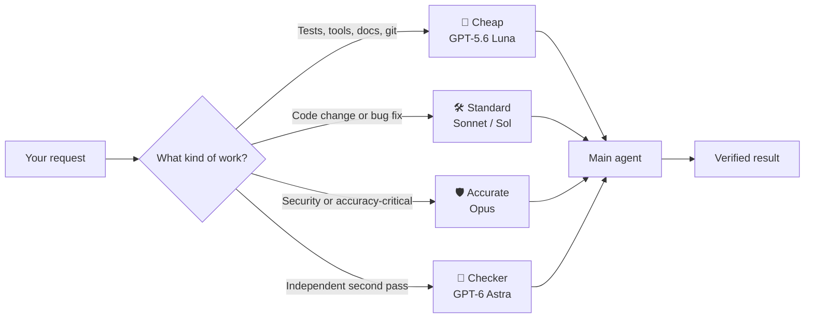
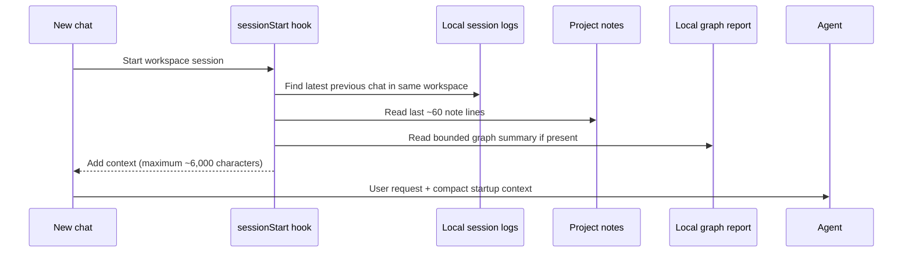
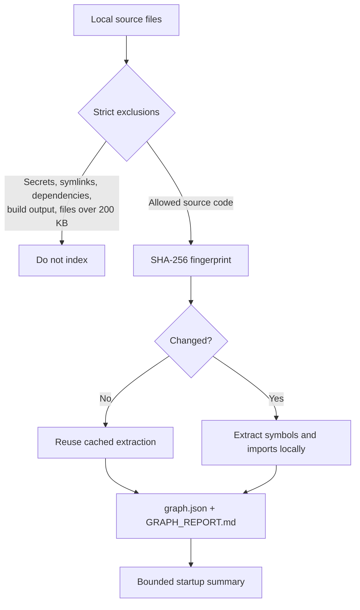
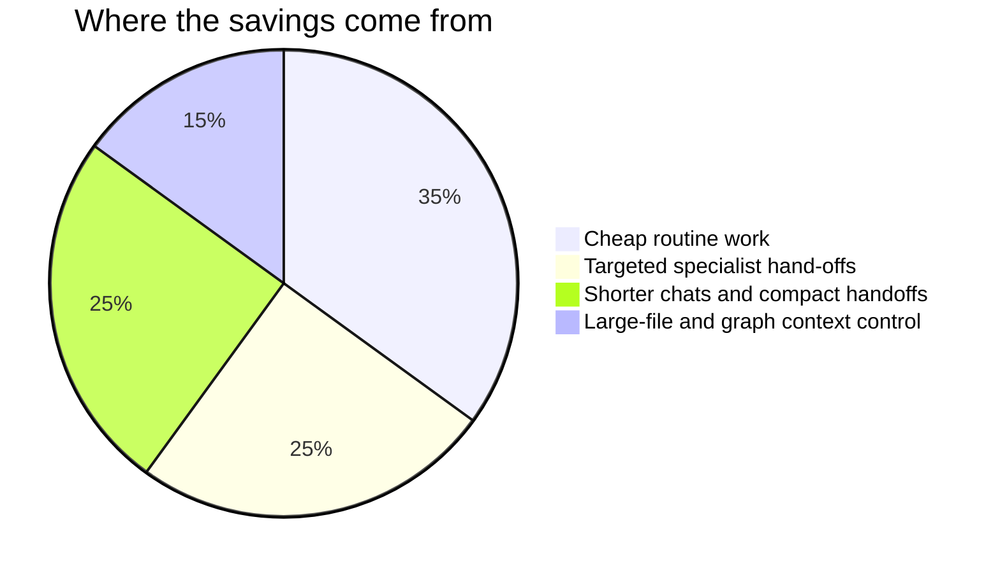

<div align="center">


# Spend-Guard

**Stop paying top-model prices for routine AI coding work.**
Spend-Guard sets up any project so GitHub Copilot uses a cheap model by default and calls in stronger
models only for the work that needs them.


</div>

---

## The problem

Coding agents make it easy to burn money without noticing:

- **One expensive model for everything.** Running a test or editing a README costs as much as designing a
  feature, because the top model is selected once and never changed.
- **Endless chats.** Every request resends the whole conversation. A chat with 300k tokens of history makes
  even a one-line question expensive.
- **Big files in context.** Reference PDFs, data dumps and huge source files get read in full, again and again.

In the logs that inspired this tool, **81% of a month's spend went to the top model**, and a single
long-running chat cost more than half the total.

## What Spend-Guard does

| | What | How |
|---|---|---|
| 💸 | **Cheap by default** | New chats in the project start on a low-cost model (`chat.defaultModel`) |
| 🧭 | **Automatic hand-off** | A main agent does routine work itself and delegates to specialists on stronger models: a developer for code, a read-only reviewer for security-sensitive changes, an accurate reader for critical documents |
| 🔁 | **Independent second pass** | For accuracy-critical extraction (handwriting, scans, invoices), a checker on a *different model family* re-reads the same locations without seeing the first answers; disagreements go to you |
| ✂️ | **Short chats** | A hook watches the chat's size. Past ~100k tokens it asks the agent to move a *new* task to a fresh chat with a short handoff |
| 📝 | **Project handoff notes** | Each project gets a small `.github/notes.md` file for durable decisions and half-done work, so new chats read context without carrying full history |
| 🚀 | **Automatic startup context** | A fast `sessionStart` hook adds capped notes and the previous same-workspace chat's recent user messages and final answer, with no model call |
| 🕸️ | **Local code graph** | An optional standard-library graph extracts code files, symbols and imports locally, caches unchanged files by SHA-256, and adds a small report to startup context |
| 📵 | **No whole big files** | Large reference files and huge source files are searched, never read whole |
| 📊 | **Spend report** | Cost per project and model from your local Copilot logs, compared with the previous period |

You don't pick agents or models: open a chat and ask. The routing happens on its own.

## Cost-saving strategy in use

We use this strategy in two production workspaces as well as in Spend-Guard itself:

| Project | How the strategy is applied |
|---|---|
| [AUTO-C / PipeTrace](https://github.com/PrashantAHD/pipetrace) | Luna is the cheap default for routine piping-tool work, documentation, validation and git. Code changes go to a standard developer. Sketches and drawings use an Opus reader plus an independent GPT-6 Astra checker; disagreements are sent to the contractor. The cost guard keeps new cases out of long chats, while startup context restores the notes and previous-chat digest automatically. |
| [Agent Doorbell](https://github.com/PrashantAHD/Agent-Doorbell) | Luna is the cheap default for tests, reinstall, health checks, logs, documentation and git. Code changes go to a standard developer, while authentication, signing, Telegram approvals/buttons, session grants and hook or extension changes receive an Opus security review. The cost guard and automatic startup context keep handoffs short and inexpensive. |

These two projects are hand-maintained integrations rather than Spend-Guard-managed
installations. Both use the same principles: spend the cheap model on predictable work,
reserve stronger models for code, security and accuracy-critical decisions, and carry only
a capped local handoff into a new chat instead of the full conversation history.

The optional graph feature deliberately uses only local code structure. It does not call a
model, access the network, process PDFs or images, run an MCP server, or start a watcher.
It excludes secret-looking files, dependency/build directories, symlinks and code files over
200 KB. Generated graph data is kept under `.github/spend-guard-graph/`; review it before
committing it because paths and symbol names can still reveal project structure.

### Model tiers

| Tier | Default models | Used for |
|---|---|---|
| cheap | GPT-5.6 Luna, GPT-5.4 nano | running tools and tests, small edits, docs, git |
| standard | Claude Sonnet 5.5, GPT-5.6 Sol | writing and fixing code |
| accurate | Claude Opus 5.5 | security reviews, accuracy-critical reading |
| checker | GPT-6 Astra, GPT-5.6 Sol | independent second pass |

Model names change often. Run `spendguard.py tiers --init`, edit `~/.copilot/spend-guard/tiers.json`, then
`spendguard.py update <project>` to switch every project at once.

## How Spend-Guard works

Spend-Guard is a project-level AI cost-control system. It keeps routine work cheap, escalates only
when the task needs more reasoning, and carries a small amount of durable context into new chats
instead of replaying the entire conversation.



### The seven cost-saving mechanisms

| # | Mechanism | What happens automatically |
|---:|---|---|
| 1 | **Cheap model by default** | New chats use the configured low-cost model, currently GPT-5.6 Luna, through `chat.defaultModel`. |
| 2 | **Automatic model routing** | The main agent sends routine work to cheap, code changes to standard, and security or accuracy-critical work to accurate tiers. |
| 3 | **Specialist agents** | Projects receive developer, read-only reviewer, extractor and independent-checker agents only when their codebase needs them. |
| 4 | **Long-chat guard** | Follow-ups continue in place, but new tasks are directed to a fresh low-cost chat once context becomes expensive. |
| 5 | **Automatic startup context** | `sessionStart` adds capped notes and a digest of the previous same-workspace chat, with no model call. |
| 6 | **Secure local code graph** | An optional standard-library graph records local symbols, imports and relationships without network access or model calls. |
| 7 | **Spend reporting** | Local Copilot logs are compared by project, model, credits, estimated cost and long-chat count. |

### Context without the history bill



The startup hook never loads the full previous transcript. It includes the previous session ID,
up to eight recent user messages, the final assistant response, project notes and an optional
bounded graph report. Missing or malformed logs fail open.

### Secure local code graph



The graph stores only relative paths, symbol names, imports, relationships and fingerprints. It
does not store source text, call a model, access the network, process PDFs or images, run an MCP
server, or start a watcher.

### Expected savings

Projects using this strategy are expected to reduce AI spend by approximately **60–85%**, depending
on how much work would otherwise use expensive models. The estimate is workload-dependent, not a
guarantee:



The graph itself has no model cost. Its value is reducing repeated context reading. Measure actual
results with:

```powershell
python .\skill\spend-guard\spendguard.py report --days 7
```

That report is based on local Copilot logs; GitHub billing remains authoritative.

## Quick start

> **You need:** Python 3.10+ and VS Code with GitHub Copilot (agent sessions).

```powershell
git clone https://github.com/PrashantAHD/spend-guard.git
cd spend-guard
powershell -ExecutionPolicy Bypass -File .\install.ps1     # macOS/Linux: ./install.sh
```

Then open a project, start a **new chat** and type **`/spend-guard`**. The agent:

1. analyses the project (languages, tests, big files, secrets, security-sensitive code);
2. proposes the specialists it needs: usually just a developer, plus a reviewer or a double-checked
   reader only where the project calls for it;
3. asks you to confirm, then writes the setup.

Commit the new files and start new chats as usual.

## What it creates in a project

```
AGENTS.md                         # a marked "Model routing" section (the rest of the file is untouched)
.github/agents/<main>.agent.md    # the cheap main agent and its routing table
.github/agents/<specialist>.agent.md
.github/hooks/spend-guard.json    # the long-chat guard hook
.github/hooks/spend_guard.py
.github/hooks/session_start.py  # automatic capped startup context from notes + previous chat
.github/hooks/spend-guard.json   # hook registration
.github/notes.md                 # short user-maintained handoff notes (created once, never overwritten)
.github/spend-guard.json          # the plan, so it can be updated or removed
.vscode/settings.json             # chat.defaultModel = the cheap model
```

Files are marked *managed by spend-guard*. It **never overwrites a file it didn't create**: it skips it and
tells you. `.github/notes.md` is deliberately user-maintained: Spend-Guard creates it only when missing and
never overwrites or deletes it. Append 1-3 lines after a task with the decision, current state, half-done work
or a gotcha; condense older entries around 60 lines. Never put secrets or client data there. `remove` deletes
only its own files and its section of `AGENTS.md`.

## Commands

The skill runs these for you; you can also run them yourself:

| Command | What it does |
|---|---|
| `python spendguard.py analyze <folder>` | Project facts as JSON |
| `python spendguard.py apply <folder> --plan plan.json [--dry-run]` | Generate the setup from a plan |
| `python spendguard.py update <folder>` | Re-render from the saved plan (e.g. after changing tiers) |
| `python spendguard.py remove <folder>` | Remove everything Spend-Guard created |
| `python spendguard.py report [--days 7]` | Cost per project and model, vs the previous period |
| `python spendguard.py tiers [--init]` | Show or customise the model tiers |
| `python spendguard.py graph <folder>` | Build a local deterministic code graph and bounded `GRAPH_REPORT.md` |

The script is in `~/.copilot/skills/spend-guard/` after installing. Plan format: see
[SKILL.md](skill/spend-guard/SKILL.md#plan-schema).

## What to expect

- **Cost:** in the projects it was built on, the estimate is a **60–85% lower spend**, depending on how much
  of the work needs the stronger tiers. Check your own with `report` after a week.
- **Quality:** unchanged for routine work and for anything your own code computes. Coding on the standard
  tier may take an extra round on hard problems; the developer reports back when it needs the accurate tier.
  Accuracy-critical reading stays on the top model, with the optional second pass.

## Good to know

- **Company or client code:** check your employer's AI policy before changing how AI tools run in their
  repositories. Spend-Guard sends nothing anywhere new; it only changes which Copilot model handles a task.
- **The guard is advice, not a lock.** The agent decides whether your message is a follow-up or a new task.
  If it carries on with a new task in a long chat, just say "new chat".
- **Cost figures are estimates** from your local Copilot logs (about $0.01 per AI credit). Only your GitHub
  billing page is authoritative.
- **Built on Copilot features that change often:** custom agents, subagents, hooks and `chat.defaultModel`.
  If routing stops working after an update, open an issue.

## Project layout

```
spend-guard/
├── skill/spend-guard/SKILL.md      # the /spend-guard skill (the judgement part)
├── skill/spend-guard/spendguard.py # analyse, apply, update, remove, report (standard library only)
├── install.ps1 / install.sh        # copy the skill to ~/.copilot/skills/spend-guard
├── tests/                          # python -m unittest discover -s tests
└── LICENSE                         # MIT
```

## License

[MIT](LICENSE) © 2026 Prashant Kumar

---

<div align="center">
<sub>Spend-Guard is an independent project and isn't affiliated with GitHub, Microsoft, Anthropic or OpenAI.</sub>
</div>
