<div align="center">


# Spend-Guard

**Stop paying top-model prices for routine AI work.**

Cheap model by default. Stronger models only when the task needs them.
At ~100k tokens, a new cheap chat starts with a short handoff — you don't paste.




<sub>Open the SVG in a browser if GitHub shows a still frame. It loops: stay → developer → reviewer → extractor → new chat.</sub>

</div>

## The idea in four beats

1. **Scan the tool** on first setup. Routing is drafted from *that* project's skills, tests and sensitive paths — not a hardcoded workflow from another product.
2. **Stay cheap** for tests, docs, git, reports and small edits. Hand off code, security review and accuracy-critical reading.
3. **Cut the chat** at ~100k tokens. The agent writes one `notes.md` line and calls `create_session` on Luna. Paste is only a fallback if that tool is missing.
4. **Stay current.** First prompt of the day in an applied tool checks for a newer Spend-Guard and asks to upgrade.

You don't pick models. Open a chat and ask.

## Why it saves money

| Without Spend-Guard | With Spend-Guard |
|---|---|
| One expensive model for tests and architecture | Luna for routine work; Sonnet/Opus only when needed |
| A 300k-token chat makes “push” as costly as a full task | Cap at ~100k, then a fresh cheap chat with notes |
| Always-on instruction files tax every turn | `validate` (and a one-line `sessionStart` warning) flags long files, references to missing paths, and duplicate Spend-Guard sections |
| A word like “latest” or “codebase” pushes a simple question onto a pricier model | Whole-word routing; questions and status checks stay cheap |
| Security review on every tweak | At most 2 rounds, Critical/High only, before a push |

In the logs that started this, **81% of a month's spend went to the top model**. Expected variable-cost cut is about **60–85%** (workload-dependent, not a guarantee). Measure with `report`; GitHub billing is authoritative.

### Measured results

Spend-Guard was added to one production project on 27 Oct 2026 and compared with projects without it over the same weeks (credits per AI call):

| Week starting | Without Spend-Guard | With Spend-Guard | Impact |
|---|---:|---:|---|
| 19 Oct (before setup) | 29 | 21.2 | baseline |
| 26 Oct (setup on 27 Oct) | 11 | 5.3 | 52% lower |
| 2 Nov | 6.5 | **1.8** | **72% lower (3.6× cheaper)** |

- **Cost per call: 21.2 → 1.8 credits (−91%)** on the Spend-Guard project.
- **Weekly saving: ~92%.** 7,691 calls cost $138 instead of ~$1,630 at the old rate (≈$1,500 saved in one week).
- **Cheap-model usage: 59%** of calls with Spend-Guard vs 30% without.

## What's new

**Instruction health checks (warn-only).** `validate` now checks `AGENTS.md`, `CLAUDE.md`, `.github/copilot-instructions.md` and `.github/instructions/*.instructions.md` for:

- **Missing paths.** Backticked or linked file paths that no longer exist. URLs, globs and placeholders like `<path>` are ignored.
- **Duplicate or conflicting Spend-Guard sections.** A section repeated in one file, start/end markers that don't pair up, or a section copied into the wrong file.
- **Oversized always-loaded files.** `applyTo: '**'` files or `.github/copilot-instructions.md` longer than 40 lines.

These are warnings; they fail `validate` only with `--strict`. The generated `sessionStart` hook runs the same local check at the start of each chat. If anything is wrong, it adds one line to the startup context: "Spend-Guard instruction health warning: … (+N more)". It makes no model or network calls and never blocks the chat.

**More accurate cheap-first routing.** `dispatch` used to match keywords anywhere inside a word, so "**latest**", "pre**fix**", "**code**base" and "**scan**ner" sent simple tasks to the coding or accuracy tier. In a sample of 23 typical tasks, 8 cheap ones were sent to a more expensive tier. Now:

- **Whole words only.** Keywords match whole words plus simple endings, so "scanned invoices" still counts as accuracy work but "scanner job" doesn't.
- **Questions stay cheap.** Questions, status checks and re-runs ("how many tokens did I spend?", "run the existing tests") stay on the cheap tier unless they ask for a change, a review or extraction.
- **Tested both ways.** A 29-case routing test set checks that cheap tasks aren't upgraded and that code, security and accuracy work isn't downgraded.

**Leaner always-loaded section.** The `AGENTS.md` routing section, sent with every request, is about 16% smaller (2,168 → 1,811 characters for the test project) after removing duplicated review-cap and long-chat text. A test keeps it under budget. The review cap is now stated correctly for projects that review on every sensitive change.

To pick these up, re-run the installer, then run `spendguard.py update <folder>` in each applied project (this regenerates the `sessionStart` hook and the `AGENTS.md` section).

## Getting the best results

Spend-Guard picks the model; these habits make sure the cheaper choice is still the right answer.

### Highest impact

1. **Make tests the gate.** Set `test_command` in the plan. The code specialist runs it after every change and, if the same problem survives two attempts, stops and reports that the task needs a stronger model. For small edits the cheap main agent makes itself, ask it to run the tests (and your linter) before it finishes.
2. **Use the independent review for risky changes.** Authentication, payments, data deletion and database migrations deserve review even when the change looks small. Keep the generated security reviewer in the plan, set `"review_policy": {"when": "on_sensitive_change"}` and give the reviewer a `when` trigger that names those areas (for example "After a change to auth/, payments/ or migrations/"), so it runs on those changes, not only before a push. It is still capped at 2 rounds and only Critical/High findings block. For accuracy-critical reading (invoices, scans, contracts), `"double_check": true` adds an independent second pass.
3. **Keep project instructions short and accurate.** Run `spendguard.py validate <folder>` regularly; the `sessionStart` hook also warns at the start of each chat. Stale paths, duplicated rules and bloated always-loaded files hurt every model's output and cost tokens on every request.

### Medium impact

4. **Respect the long-chat guard.** Start a new chat for each new task. Long chats make every model, including premium ones, more likely to mix up context, and they make every turn more expensive.
5. **Refresh the code graph after big refactors.** Run `spendguard.py graph <folder>` so the startup summary (`.github/spend-guard-graph/GRAPH_REPORT.md`) doesn't point the agent at old structure. If the project's shape changed (new sensitive areas, new test command), run `propose` again and `apply` the revised plan.
6. **Write clear task descriptions.** Routing is more accurate, and cheap models make fewer mistakes, when the task is explicit:

   ```text
   Goal: add pagination to GET /orders (page, page_size; max 100).
   Files: src/api/orders.py, tests/test_orders.py
   Done when: python -m pytest tests/test_orders.py passes and the old behaviour is unchanged without params.
   ```

### Low effort

7. **Check the usage report monthly.** Run `spendguard.py report --days 30`. If a project keeps landing on premium models for routine work, add a `cheap_overrides` entry for that workflow. If a cheap model keeps failing on one type of task, route that type to a specialist permanently in the plan, then `update`.

## Model tiers

| Tier | Default models | Used for |
|---|---|---|
| cheap | GPT-5.6 Luna, GPT-5.4 nano | tools, tests, small edits, docs, git |
| standard | Claude Sonnet 5.5, GPT-5.6 Sol, Grok 4.7 | writing and fixing code |
| accurate | Claude Opus 5.5 | security review, accuracy-critical reading |
| checker | GPT-6 Astra, Grok 4.7, GPT-5.6 Sol | independent second pass |

Names change. `spendguard.py tiers --init`, edit `~/.copilot/spend-guard/tiers.json`, then `update` each project.

## Quick start

Python 3.10+ and VS Code with GitHub Copilot (agent sessions).

```powershell
git clone https://github.com/PrashantAHD/spend-guard.git
cd spend-guard
powershell -ExecutionPolicy Bypass -File .\install.ps1     # macOS/Linux: ./install.sh
```

In the target project, start a **new** chat and type **`/spend-guard`**. Confirm the proposed specialists, then commit the generated files.

Company or client repos: check that policy allows changing how AI tools run. Spend-Guard does not send code anywhere new.

## What it writes

```
AGENTS.md
.github/agents/                 # cheap main agent + specialists
.github/hooks/                  # 100k guard + sessionStart
.github/notes.md                # your handoff notes (created once, never overwritten)
.github/spend-guard.json        # the plan
.vscode/settings.json           # chat.defaultModel = cheap
```

Marked *managed by spend-guard*. It never overwrites a file it did not create. Optional Claude skills if the plan includes `"providers": ["copilot", "claude"]`.

## Commands

After install, the script lives in `~/.copilot/skills/spend-guard/`.

| Command | What it does |
|---|---|
| `analyze <folder>` | Project facts as JSON |
| `propose <folder>` | Draft a routing plan from that scan |
| `apply <folder> --plan plan.json` | Generate the setup (`--dry-run` to preview) |
| `update <folder>` | Re-render from the saved plan |
| `remove <folder>` | Remove only what Spend-Guard created |
| `stale [folder …]` | List applied tools behind this version |
| `validate <folder> [--strict]` | Audit setup and instruction health with no project/model/network run |
| `report [--days 7]` | Cost per project and model vs the previous period |
| `tiers [--init]` | Show or customise model tiers |
| `graph <folder>` | Local code graph (no model, no network) |
| `memory search <folder> <query>` | Search local chats (optional `--all-workspaces`) |
| `dispatch <folder> <task>` | Route-only Copilot vs free external provider (whole-word, cheap-first) |

Plan schema: [SKILL.md](skill/spend-guard/SKILL.md#plan-schema).

## Guardrails worth knowing

- **The 100k hook is advice to the agent**, not a hard lock. In Agent sessions it should call `create_session`. In plain Copilot Chat it may still ask you to paste.
- **Upgrade check** on the first prompt of the day may fetch the published version once; it fails open and stays quiet the rest of the day.
- **No secrets in `notes.md`.** Graph and memory search skip `.env`, keys and credential-like values.
- **External providers** are opt-in, `free_only`, and never replace Copilot's own endpoint.
- Spend-Guard does not cut the Copilot subscription price, guarantee identical model output, or replace tests and human review.

## License

[MIT](LICENSE) © 2026 Prashant Kumar

---

<div align="center">
<sub>Spend-Guard is independent and isn't affiliated with GitHub, Microsoft, Anthropic or OpenAI.</sub>
</div>
